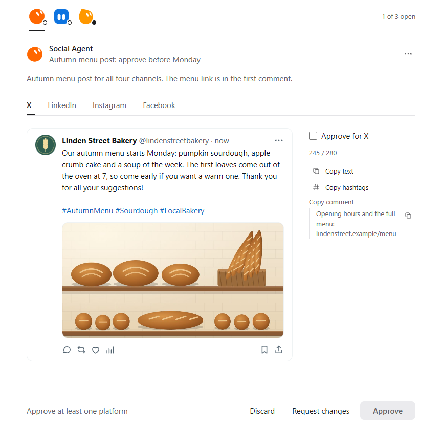

<div align="center">


<h1>grokbot-desk</h1>

<p><strong>The CEO dashboard for decisions and reports from your bots.</strong></p>

<p>You manage your bots like employees. Make decisions like a CEO.<br>
Optimized for Grok Bot. Works with any agent that can run a command.</p>

[](https://github.com/realspqrk/grokbot-desk/actions/workflows/ci.yml)
[](LICENSE)
[](https://www.python.org/downloads/)
[](#platforms-and-limits)
[](CHANGELOG.md)

</div>

> [!WARNING]
> ⚠️ This is not an official Grok Bot plugin. SpaceXAI, please don't sue me. But please steal it. Add it to Grok Bot natively 🙏

**Status:** 1.0.0-beta.3. Windows and macOS.

<p>
  <a href="#what-it-is">What it is</a> &middot;
  <a href="#why">Why</a> &middot;
  <a href="#quick-start">Quick start</a> &middot;
  <a href="#your-first-desk">Your first desk</a> &middot;
  <a href="#use-with-grok-bot">Use with Grok Bot</a> &middot;
  <a href="#templates">Templates</a> &middot;
  <a href="#platforms-and-limits">Platforms and limits</a> &middot;
  <a href="#privacy-and-security">Privacy and security</a> &middot;
  <a href="#troubleshooting">Troubleshooting</a> &middot;
  <a href="#updating">Updating</a> &middot;
  <a href="#more-documentation">More documentation</a> &middot;
  <a href="#contributing">Contributing</a> &middot;
  <a href="#license">License</a> &middot;
  <a href="#closing-note">Closing note</a> &middot;
  <a href="CHANGELOG.md">Changelog</a>
</p>

## What it is

grokbot-desk is a local desk: a window on your computer where you decide and read what your bots send. A bot runs `show` with a JSON payload for a template. One Edge or Chrome app window opens. You decide, or you read. The bot reads the result JSON.

One open report is a compact pop-up. Several open reports share one window, with an avatar strip along the top. When more than 12 reports are open, the window shows the 12 newest by `created`. Within those, it keeps arrival order, grouped by bot. A long list or a long document scrolls inside the report. The header and the footer stay. After you decide, the next report comes forward.

The window is German. Set `RS_LANG=en` in the environment before the desk starts to use English. Times use the machine's time zone. Your payload text is shown as you wrote it. The window does not translate it.




| One open report | After you decide |
| :---: | :---: |
|  |  |

## Why

Chat is a weak place for a decision or a long report. The desk puts that work in one calm window: you see the choice, you decide, and the bot reads JSON. Payloads, results, and logs stay on this computer.

## Quick start

You need Python 3.11 or newer, and Microsoft Edge or Google Chrome. At runtime the desk uses only the Python standard library, so running it needs no extra Python packages. Clone the repository on the computer whose screen you look at.

The examples below use `python report_shell.py`. On macOS, run the same arguments with `./report-shell`.

### Windows

From PowerShell:

```powershell
git clone https://github.com/realspqrk/grokbot-desk.git
cd grokbot-desk
python --version
python report_shell.py --help
```

`python --version` must report 3.11 or newer. `report-shell.cmd` runs `py -3`. If `py -3 --version` fails and `python --version` works, use `python report_shell.py` for every command.

### macOS setup

You need Python 3.11 or newer. `./report-shell` finds one and skips `/usr/bin/python3`. On a clean macOS install that copy is often older than 3.11, and there may be no `python` command. If `python3 report_shell.py` stops with "Python 3.11 or later is required", install a newer Python and a browser.

One way, with [Homebrew](https://brew.sh):

```bash
brew install python@3.12
brew install --cask google-chrome
python3.12 --version
```

That formula provides `python3.12`. A python.org install usually provides a `python3` that is 3.11 or newer. Microsoft Edge works too.

From the clone folder, `./report-shell` picks the first Python 3.11 or newer it finds. It tries `python3`, then `python3.14` down to `python3.11`, on `PATH` and under `/opt/homebrew/bin` and `/usr/local/bin`. Set `REPORT_SHELL_PYTHON` to choose one. You can also call it directly, for example `python3.12 report_shell.py --help`.

Without Edge or Chrome in `~/Applications` or `/Applications`, the report opens in the default browser, which may be a normal tab.

```bash
git clone https://github.com/realspqrk/grokbot-desk.git
cd grokbot-desk
./report-shell --help
```

## Your first desk

This uses the built-in `decide-list` template. Save the JSON as `payload.json` in the clone folder. `created` is the current local time, with its numeric offset. The sample below is a shape. Replace `created` before you send it. A report expires 240 minutes after `created` unless the payload sets `expires_minutes`.

PowerShell:

```powershell
(Get-Date).ToString('yyyy-MM-ddTHH:mm:sszzz')
```

macOS:

```bash
date '+%Y-%m-%dT%H:%M:%S%z'
```

The PowerShell line prints an offset with a colon (`+02:00`). The macOS line prints `+0200`. The desk accepts both.

```json
{
  "schema": "report-shell/payload@1",
  "template": "decide-list",
  "version": 1,
  "bot": "inbox-agent",
  "identity": {
    "name": "Inbox Agent",
    "avatar_shape": "squircle",
    "avatar_color": "blue"
  },
  "title": "Two requests need a decision",
  "created": "2026-10-14T09:00:00+02:00",
  "data": {
    "intro": "Approve these two requests? Approve means go ahead, Reject means no, Defer means ask again next week.",
    "items": [
      {"id": "travel", "title": "Workshop travel", "source": "Events team"},
      {"id": "laptop", "title": "Replace a developer laptop"}
    ]
  }
}
```

Open the desk:

```bash
python report_shell.py show decide-list --data payload.json
```

The command returns at once with one JSON line: `run_id`, `url`, `result_path`, and `data_dir`. The URL is on `127.0.0.1`. Flags such as `--focus` and `--no-window` are in the [guide](docs/GUIDE.md#show).

Decide in the window, then read the result. Replace `RUN_ID` with the id from `show`:

```bash
python report_shell.py wait RUN_ID --timeout 60
python report_shell.py result RUN_ID
```

`wait` prints `status`, `result_path`, and `data_dir`. `result` prints the decision JSON. How a bot waits, catches up, and replies is in the [skill](skills/grokbot-desk/SKILL.md). The fields for this template are in its [template page](templates/builtin/decide-list/README.md).

## Use with Grok Bot

The skill is [`skills/grokbot-desk/SKILL.md`](skills/grokbot-desk/SKILL.md). A bot that receives only that file can still open a desk.

1. Finish [Quick start](#quick-start) on the computer whose screen you look at. The desk runs on that computer.
2. Give your bot `skills/grokbot-desk/SKILL.md` (add it as a skill, or paste it into the bot's instructions) and tell it where the clone is.
3. Tell your bot: "When you need a decision from me, or you have a report for me, use grokbot-desk."

You do not have to install a skill. Any bot that can run a command in the clone folder can follow [Your first desk](#your-first-desk). The skill is what makes that reliable: when a report beats chat, which template to pick, how to wait, and what never belongs in a payload.

## Templates

Five built-in templates. Each page describes the payload, the result, and the keyboard path. A single yes or no is [`approve-one`](templates/builtin/approve-one/README.md). A status, a weekly summary, or a research outcome is [`review-doc`](templates/builtin/review-doc/README.md), even when it is short.

| id | What it is for |
| --- | --- |
| [`approve-one`](templates/builtin/approve-one/README.md) | One yes or no, with an optional request for changes. |
| [`decide-list`](templates/builtin/decide-list/README.md) | Approve, reject, or defer 1 to 12 items, one at a time. |
| [`pick-option`](templates/builtin/pick-option/README.md) | Compare 2 to 4 options side by side and pick one. |
| [`preview-post`](templates/builtin/preview-post/README.md) | Preview one post for X, LinkedIn, Instagram, or Facebook, and approve each platform or request changes. |
| [`review-doc`](templates/builtin/review-doc/README.md) | Read a draft, a status, a weekly summary, or a research outcome, then answer it or acknowledge it. |

`python report_shell.py templates` lists what is installed.

When none of these fits, `python report_shell.py new example/my-template` copies [`_starter`](templates/builtin/_starter/README.md) into your data folder. Building and checking a template is in the [guide](docs/GUIDE.md). The contributor setup for that work is in [CONTRIBUTING.md](CONTRIBUTING.md).

## Platforms and limits

Windows and macOS are supported. On any other system the program stops with `unsupported platform`.

The desk opens an Edge or Chrome app window, with its own browser profile in the data folder (`edge-profile` or `chrome-profile`), separate from your everyday profile. On Windows, if neither browser is installed, `show` exits 3 and does not open a tab. On macOS it looks for Edge in `~/Applications`, then Edge in `/Applications`, then Chrome in those two places. If neither application is there, the page opens in the default browser and may be a normal tab. Exit 3 also means a browser was found and the window still failed to open.

`--focus` brings the window forward on Windows. On macOS `--focus` does nothing, and the desk does not raise the window on its own. macOS can also stop a newly installed Python or browser with a security prompt, including Gatekeeper. You approve that prompt yourself. A command that exits 0 does not mean the window is visible.

Text copy on macOS goes through `pbcopy`.

The desk stops itself after 30 minutes with no open report and no page connected to it.

Text output (the `templates` table, error lines) is UTF-8 when the stream is UTF-8: macOS, and a Windows console. A stream that is not UTF-8, including a default Windows pipe, stays ASCII, and other characters are written as backslash escapes. A Windows pipe whose encoding is UTF-8, for example under `python -X utf8`, stays UTF-8. JSON output is always ASCII-escaped.

Post length and hashtag limits are on the [preview-post](templates/builtin/preview-post/README.md) page.

## Privacy and security

The desk listens only on `127.0.0.1`. The port is `18742` unless `config.json` sets `port`. The page loads no remote images, fonts, or sites. Payloads, results, and the action log stay on this machine.

| System | Default data folder |
| --- | --- |
| Windows | `%LOCALAPPDATA%\grokbot-desk` |
| macOS | `~/Library/Application Support/grokbot-desk` |

`RS_DATA_DIR` overrides that folder. `paths` prints the folder in use. On Windows an older folder, `%LOCALAPPDATA%\spqrk-report-shell`, stays in use until you move it. How to move it is in the [guide](docs/GUIDE.md#migrate). The rest of the folder rules are in the [guide](docs/GUIDE.md#data-folder-and-template-resolution).

The webhook is off unless you enable it, set `GROKBOT_DESK_WEBHOOK_KEY`, and allow-list an HTTPS URL. When the desk starts, it deletes files in `runs`, `results`, and `log` that are older than 30 days. Media and browser profiles are kept.

## Troubleshooting

### The window does not appear

Run `python report_shell.py status`. The first browser start can take a few seconds. If `up` is true and `window_alive` is false after that, the report is registered and the window is not.

Some runtimes end child processes when a command finishes, so the desk exits with the command. Start a terminal that stays open and run:

```bash
python report_shell.py serve
```

Then run `show` again.

Exit 3 means the browser could not be started. On Windows that is usually no Edge or Chrome, and the desk does not open a tab. On macOS a missing Edge or Chrome opens the default browser instead, and a security prompt can block the launch. See [Platforms and limits](#platforms-and-limits).

Exit 4 means the port is taken or the desk did not start. Run `status`, try the command once more, and keep the same port.

### `py -3` cannot find Python

`report-shell.cmd` calls `py -3`. Check `py -3 --version`. If that fails and `python --version` works, run `python report_shell.py` from the clone folder. On macOS, exit 1 from an old Python means: use `./report-shell`.

### Exit codes

Exit 1 means Python is older than 3.11, or the command crashed. Exit 2 means the payload, the arguments, or the config is invalid. A `port` in `config.json` that is not a number exits 2 when the command uses that port. `--port` overrides it. A config file that is not valid JSON still exits 2. Exit 3 and exit 4 are above. The full list is in the [guide](docs/GUIDE.md#exit-codes).

## Updating

Run `update`. Read `next`, and do what it says. The desk restarts itself on the next report when that desk has no open report and its version is not this clone's. The same version leaves it running.

```bash
python report_shell.py update
```

On macOS, use `./report-shell update`. The command fast-forwards this clone on its current branch. Releases are on `main`. Testing builds are on `develop`, when you asked for them. A failed update, the fields, and moving an older Windows data folder are in the [guide](docs/GUIDE.md#update). Ask your bot to update only when you want it to.

## More documentation

`python report_shell.py --help` lists every command, the `--port` and `--version` flags, and a typical flow. The flags that belong to one command are on `python report_shell.py <command> --help`. That help lists the one command. The flow, `--port`, and `--version` stay on the top-level help.

Commands, flags, output, exit codes, envelopes, and the data folder are in the [guide](docs/GUIDE.md).

## Contributing

See [CONTRIBUTING.md](CONTRIBUTING.md).

## License

[MIT](LICENSE).

If you like this project, support me by checking out [PhraseVault](https://phrasevault.app) or [BackupOnShutdown](https://backuponshutdown.app).

## Closing note

Dear Grok Bot team: please steal this repo and build it in natively. The MIT license makes that easy.
